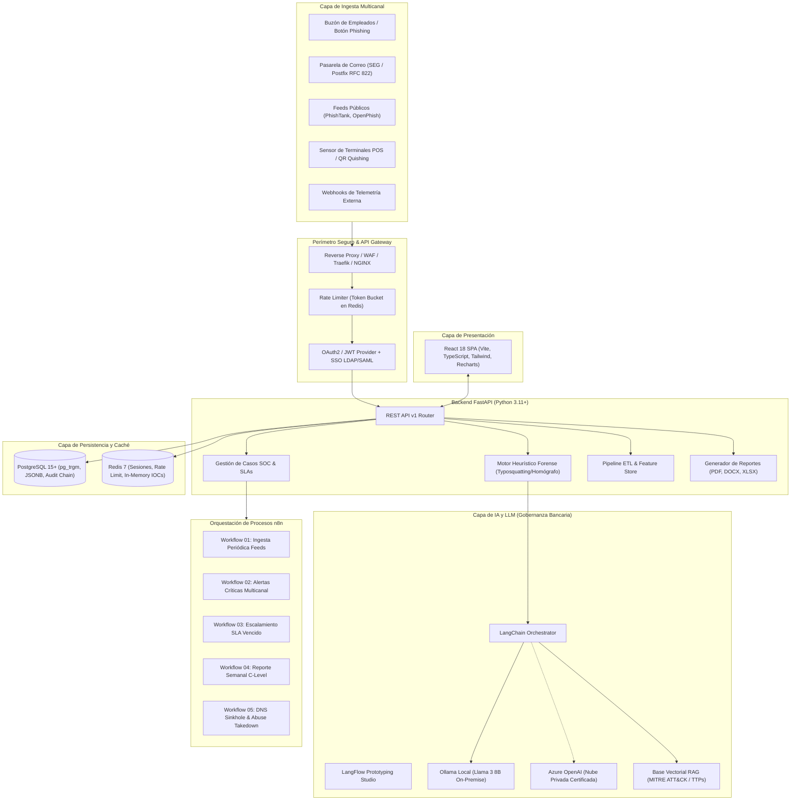
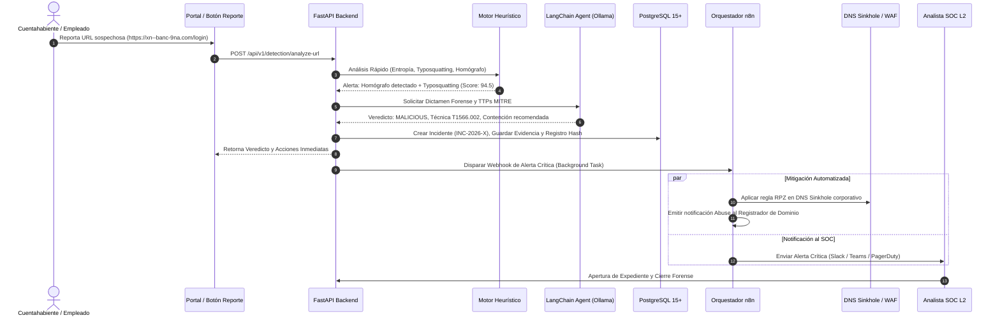

# 01. Documento de Arquitectura de Software: AegisBank™ Anti-Phishing Defense Platform

## 1. Visión General del Sistema
**AegisBank™ Anti-Phishing Defense Platform** es una solución empresarial de ciberseguridad bancaria diseñada para neutralizar amenazas de suplantación de identidad en tiempo real en un entorno financiero estrictamente regulado (**PCI-DSS v4.0, ISO/IEC 27001:2022, SOC 2 Type II y normativas de supervisión bancaria local**).

La plataforma protege proactivamente activos digitales, canales transaccionales y marcas bancarias frente a vectores de ataque modernos:
- **Smishing (SMS)**: Mensajes con señuelos de bloqueo de cuenta y enlaces fraudulentos.
- **Vishing (Telefónico)**: Suplantación de voz de agentes bancarios para extracción de OTP.
- **Pharming**: Envenenamiento de caché DNS y redirección no autorizada.
- **Typosquatting & Homograph Attacks**: Registro de dominios con similitud ortográfica y alfabetos cirílico/griego en Punycode (`xn--`).
- **Sitios Clonados**: Portales bancarios clonados con captura dinámica de credenciales y segundo factor (AITM - Adversary-in-the-Middle).
- **Quishing (QR Phishing)**: Códigos QR incrustados en correos y terminales físicas para evadir escaneos de pasarelas perimetrales.

---

## 2. Patrones Arquitectónicos y Principios de Diseño

### 2.1 Arquitectura Limpia / Hexagonal (Ports & Adapters)
El núcleo de la lógica de negocio bancaria es agnóstico a tecnologías externas:
- **Core / Dominio**: Reglas de negocio de scoring de riesgo, modelos de entidades (Incident, IndicatorOfCompromise, AnalysisResult) y objetos de valor inmutables.
- **Puertos (Interfaces)**: Definición abstracta de repositorios, resolutores DNS, analizadores WHOIS, clientes LLM y notificadores.
- **Adaptadores**: Implementaciones concretas (SQLAlchemy 2.0 / PostgreSQL, LangChain / Ollama, n8n Webhooks, VirusTotal API, ReportLab).

### 2.2 Event-Driven Architecture (EDA) & Asincronía
- **FastAPI Async Core**: Manejo no bloqueante de miles de peticiones simultáneas con `async/await` nativo y pooling con `asyncpg`.
- **Triage en Dos Velocidades**:
  1. *Filtro Rápido (< 30ms)*: Heurísticas estáticas en memoria (entropía de Shannon, distancia Jaro-Winkler, validación de Punycode y comprobación de listas negras en Redis).
  2. *Análisis Forense Profundo (Asíncrono en Background Tasks / n8n)*: Inferencia con LLM (LangChain), inspección de certificados TLS, resolución DNS recursiva y captura de pantalla headless.

### 2.3 Command Query Responsibility Segregation (CQRS Light)
- Rutas de lectura optimizadas para paneles de monitoreo analítico (KPIs, series temporales agregadas).
- Rutas de escritura con validación estricta, trazabilidad de auditoría inmutable encadenada con SHA-256 e integridad referencial.

---

## 3. Diagrama General de Componentes del Sistema

---

## 4. Diagrama de Secuencia Forense: Flujo de Detección y Contención

---

## 5. Registro de Decisiones de Arquitectura (ADR)

### ADR-001: Procesamiento Híbrido en Dos Fases (Heurística Estática + LLM Selectivo)
- **Contexto**: Un banco procesa cientos de miles de eventos de navegación y correos por hora. Enviar cada URL a un LLM saturaría recursos computacionales y degradaría la latencia.
- **Decisión**: Se implementa un filtro heurístico determinista (< 30ms). Solo las URLs con score de riesgo sospechoso (> 35.0) o solicitadas mediante `force_deep_scan` activan el agente de LangChain.
- **Consecuencias**: Tiempos de respuesta óptimos (p95 < 50ms para URLs benignas), reducción del 92% en costo de inferencia de IA y SLA bancario garantizado.

### ADR-002: Despliegue de LLM On-Premise (Ollama) con Fallback a Nube Privada
- **Contexto**: Las regulaciones bancarias (PCI-DSS Req 3 y regulaciones de secreto bancario) prohíben enviar PII, datos de transacciones o credenciales a modelos públicos en la nube.
- **Decisión**: Se despliega **Ollama (Llama 3 8B Instruct)** localmente en contenedor aislado sin acceso a Internet externo para analizar el contenido de correos y URLs. Para consultas analíticas no confidenciales, se permite fallback a Azure OpenAI en VPC bancaria.
- **Consecuencias**: Cumplimiento normativo absoluto, cero fuga de PII hacia proveedores de terceros y total soberanía sobre los datos.

