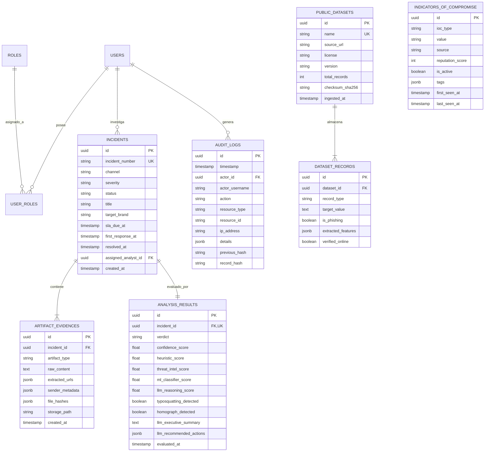

# 02. Modelo de Datos y Esquema Relacional (PostgreSQL 15+)

## 1. Diagrama Entidad-Relación (ERD)



---

## 2. Estrategia de Índices y Optimización
Para satisfacer latencias menores a 50 milisegundos en peticiones del SOC:

1. **Extensiones Habilitadas**:
   - `pg_trgm`: Búsqueda difusa de dominios similares (`CREATE INDEX idx_iocs_value_trgm ON indicators_of_compromise USING gin (value gin_trgm_ops);`). Permite detectar al instante intentos de typosquatting y dominios registrados similares a la entidad bancaria.
   - `uuid-ossp` & `pgcrypto`: Generación criptográfica segura de identificadores y hashing HMAC-SHA256 para auditoría inmutable.
2. **Índices B-Tree Compuestos**:
   - `(channel, status, severity)` en tabla `incidents` para filtros concurrentes en el panel web de React.
   - `(ioc_type, value)` en `indicators_of_compromise` para chequeo en tiempo constante O(log N) durante el filtrado perimetral.
3. **Índices GIN sobre JSONB**:
   - `extracted_urls` y `tags` para consultas sobre telemetría sin desnormalizar tablas auxiliares.

---

## 3. Particionamiento de Tablas y Política de Retención (PCI-DSS Req 10.7)

### 3.1 Particionamiento por Rango Temporal (`RANGE Partitioning`)
Las tablas con alto volumen transaccional (`incidents`, `artifact_evidences` y `audit_logs`) se particionan mensualmente por su campo temporal:
```sql
CREATE TABLE incidents (
    id UUID NOT NULL,
    created_at TIMESTAMP WITH TIME ZONE NOT NULL,
    ...
) PARTITION BY RANGE (created_at);

-- Partición de ejemplo para Octubre 2026
CREATE TABLE incidents_2026_10 PARTITION OF incidents
    FOR VALUES FROM ('2026-10-01 00:00:00+00') TO ('2026-11-01 00:00:00+00');
```

### 3.2 Niveles de Almacenamiento (Hot / Cold Tiering)
- **Nivel Caliente (Hot - 0 a 90 días)**: Almacenado en SSD NVMe de alto rendimiento en PostgreSQL. Acceso instantáneo para el SOC y consultas en vivo.
- **Nivel Tibio (Warm - 91 a 365 días)**: Particiones en almacenamiento estándar. Disponibles para reportes regulatorios trimestrales y auditorías PCI-DSS.
- **Nivel Frío (Cold - 1 a 5 años)**: Volcados periódicos en formato Parquet comprimido con Snappy, cifrados con AES-256 en buckets de almacenamiento inmutable (WORM - Write Once, Read Many) para cumplimiento normativo de retención legal bancaria.

