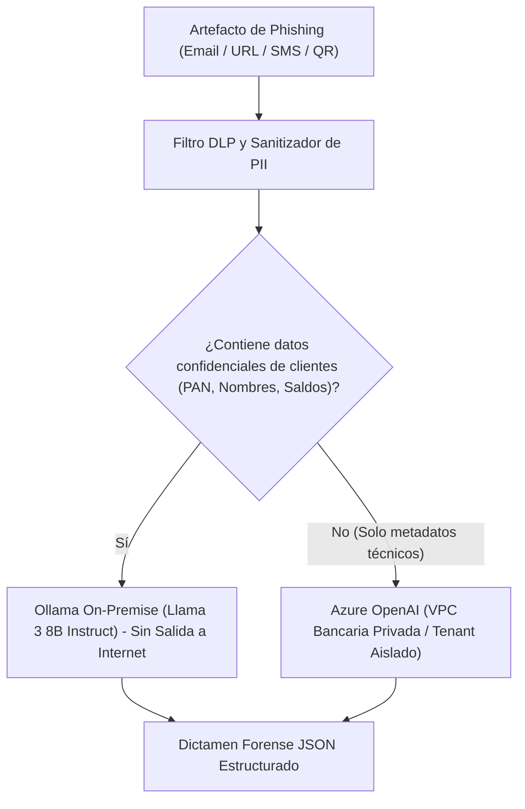

# 06. Integración de Inteligencia Artificial: LangChain y LangFlow

## 1. Estrategia y Justificación Técnica de Frameworks

| Criterio | LangChain (Backend Productivo) | LangFlow (Prototipado Visual y SOC Lab) |
| :--- | :--- | :--- |
| **Rol en la Plataforma** | Ejecución determinista, serialización tipada con Pydantic v2, integración asíncrona en FastAPI y pruebas automatizadas en CI/CD. | Entorno gráfico interactivo de bajo código para que analistas y cazadores de amenazas diseñen nuevos grafos de razonamiento sin tocar código Python. |
| **Gobernanza** | Control de versiones estricto (Git), auditoría estricta de prompts y pruebas de regresión. | Exportación en JSON del flujo visual que luego es importado o validado por los ingenieros de ciberseguridad. |
| **Resiliencia** | Manejo de excepciones, reintentos con backoff exponencial y fallbacks automáticos hacia heurísticas deterministas en caso de timeout del LLM. | Monitoreo visual de la ejecución paso a paso durante fases de calibración y pruebas de concepto. |

---

## 2. Política de Privacidad Bancaria y Enrutamiento de Prompts



- **Modelo Primario (On-Premise)**: **Ollama ejecutando `llama3:8b-instruct-q8_0`** en infraestructura local del banco. Garantiza que ninguna credencial, número de tarjeta o metadato de cuentahabiente salga del perímetro de seguridad bancario.
- **Modelo Secundario (Nube Privada)**: **Azure OpenAI (GPT-4o)** en una suscripción bancaria aislada con acuerdos BAA (Business Associate Agreement) y certificación SOC 2 / PCI-DSS, reservado exclusivamente para análisis de telemetría de amenazas a gran escala y reportes regulatorios consolidados.

---

## 3. Módulos Específicos con Implementación de IA

### 3.1 Agente Forense de Análisis de Artefactos (LangChain ReAct Agent)
- **Objetivo**: Evaluar la intencionalidad maliciosa de URLs y correos sospechosos combinando telemetría heurística con conocimiento sobre tácticas de ciberdelincuentes.
- **Herramientas Disponibles para el Agente (Custom Tools)**:
  1. `DnsResolverTool`: Consulta registros A, MX, NS y TXT del dominio.
  2. `WhoisAgeCalculatorTool`: Determina los días de antigüedad del dominio. Dominios con menos de 14 días reciben penalización severa.
  3. `EntropyCalculatorTool`: Calcula la entropía de Shannon sobre subdominios para detectar DGA (Domain Generation Algorithms).
  4. `HomographDetectorTool`: Analiza caracteres Punycode e IDN.
- **Estructura del Prompt Forense**:
```text
SYSTEM: Eres un Analista Forense Senior del SOC Bancario y Arquitecto de Ciberseguridad.
Tu tarea es emitir un dictamen técnico riguroso sobre un artefacto sospechoso, apegándote a MITRE ATT&CK.

CRITERIOS:
1. Jamás transmitas ni expongas datos sensibles de cuentahabientes (PAN, CVV, passwords).
2. Si detectas dominios con similitud fonética hacia la marca oficial (typosquatting) o caracteres no latinos (homógrafos), clasifica como MALICIOUS.
3. Analiza las técnicas de persuasión psicológica: falsas alertas de bloqueo de cuenta, urgencia y suplantación de identidad.

FORMATO DE SALIDA (JSON ESTRICTO):
{
  "executive_summary": "Resumen técnico de 2-3 oraciones",
  "technical_verdict": "BENIGN" | "SUSPICIOUS" | "MALICIOUS",
  "confidence_score": 0.0 a 1.0,
  "attack_techniques_mitre": ["T1566.002", "T1583.001"],
  "targeted_assets": ["Credenciales Banca Móvil", "Token OTP"],
  "containment_steps": ["Paso 1", "Paso 2", "Paso 3"]
}
```

---

### 3.2 RAG sobre Base de Conocimiento de Amenazas Bancarias y MITRE ATT&CK
- **Objetivo**: Proveer al analista y al motor de scoring contexto inmediato sobre técnicas de ataque financiero emergentes (por ejemplo: campañas AITM con Evilginx2, bypass de OTP por WebRTC o campañas de Quishing masivo en facturación electrónica).
- **Arquitectura RAG**:
  - **Vector Store**: `ChromaDB` local o extensión `pgvector` en PostgreSQL.
  - **Modelo de Embeddings**: `nomic-embed-text` (local vía Ollama) o `text-embedding-3-small` (Azure OpenAI).
  - **Estrategia de Búsqueda**: Búsqueda híbrida (Dense Vector Similarity + Reciprocal Rank Fusion con BM25) para garantizar precisión en identificadores exactos (ej. `T1566.002`).

---

### 3.3 Asistente Conversacional para Analistas del SOC (SOC Copilot)
- **Objetivo**: Acelerar el triaje operacional de analistas L1 guiándolos en los pasos de aislamiento, consulta de reputación histórica y redacción de minutas de incidentes.
- **Implementación**: Interfaz de chat interactivo en React integrada con `/api/v1/ai/copilot-chat`, con memoria contextual de la sesión (`ConversationBufferWindowMemory`) y soporte para streaming de respuestas (SSE).

