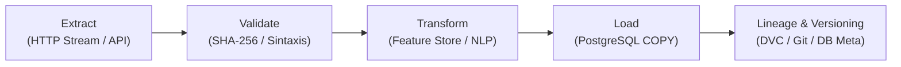

# 07. Pipeline ETL e Ingesta del Dataset Público de Phishing

## 1. Selección y Especificación del Dataset Público

Para el benchmark, calibración heurística y pruebas de laboratorio de la plataforma, se utiliza una combinación de datasets públicos reconocidos internacionalmente:

1. **PhishTank Validated Online Feed**
   - **Fuente**: [PhishTank Data Feed](http://data.phishtank.com/)
   - **Licencia**: Open Data Commons Attribution License (ODC-By) / Creative Commons BY 3.0.
   - **Tamaño y Frecuencia**: Feed continuo actualizado cada 60 minutos con un promedio de 25,000 a 40,000 URLs activas verificadas por la comunidad.
   - **Atributos Originales**: `phish_id`, `url`, `phish_detail_url`, `submission_time`, `verified`, `verification_time`, `online`, `target`.

2. **Kaggle Phishing Email Corpus / Mendeley Financial Phishing Dataset**
   - **Fuente**: Kaggle Open Datasets & Mendeley Data.
   - **Licencia**: CC BY 4.0 International.
   - **Tamaño**: ~18,000 correos etiquetados (Spam, Phishing y Ham bancario legítimo).
   - **Atributos**: `sender`, `recipient`, `subject`, `body_text`, `urls_count`, `label`.

---

## 2. Arquitectura del Pipeline ETL de 5 Etapas

### Etapa 1: Extract (Extracción)
- Descarga segura mediante cliente asíncrono `httpx` con timeout de 15 segundos y cabecera institucional `User-Agent`.
- Descarga en streaming por bloques para evitar saturación de memoria RAM en servidores de producción.

### Etapa 2: Validate & Sanitize (Validación e Integridad)
- **Cálculo de Huella Criptográfica**: Se computa el hash SHA-256 del contenido crudo para garantizar no repudio y verificar que no haya sido alterado en tránsito.
- **Filtrado Sintáctico**: Descarte de líneas vacías, URLs con longitud menor a 10 caracteres o sin prefijo de protocolo válido (`http://` o `https://`).
- **Deduplicación Canónica**: Normalización de dominios a minúsculas y eliminación de puertos estándar `:80` y `:443` para evitar registros duplicados.

### Etapa 3: Transform (Ingeniería de Características Forenses)
Cada registro es transformado calculando métricas adicionales:
- `entropy`: Entropía de Shannon del FQDN para identificar dominios aleatorios generados por algoritmos (DGA).
- `homograph_flag`: Flag booleano que detecta prefijos Punycode `xn--` o caracteres no latinos.
- `typosquatting_flag`: Distancia de Jaro-Winkler frente a dominios bancarios oficiales.
- `target_brand`: Identificación de la institución financiera suplantada.

### Etapa 4: Load (Carga Transaccional)
- Inserción masiva optimizada en las tablas `public_datasets` y `dataset_records` dentro de una transacción asíncrona única en PostgreSQL.
- Se crean índices B-Tree y GIN con `pg_trgm` para acelerar las búsquedas difusas sobre los registros cargados.

### Etapa 5: Versionado y Linaje de Datos
- Cada corrida del pipeline genera un registro en la tabla `public_datasets` con versión semántica (ej. `2026.10-daily.1`), fecha de ingesta, total de registros procesados y hash SHA-256.
- Integración con **DVC (Data Version Control)** y Git LFS para registrar los snapshots de datos y permitir la reproducibilidad de experimentos en modelos de Machine Learning.

