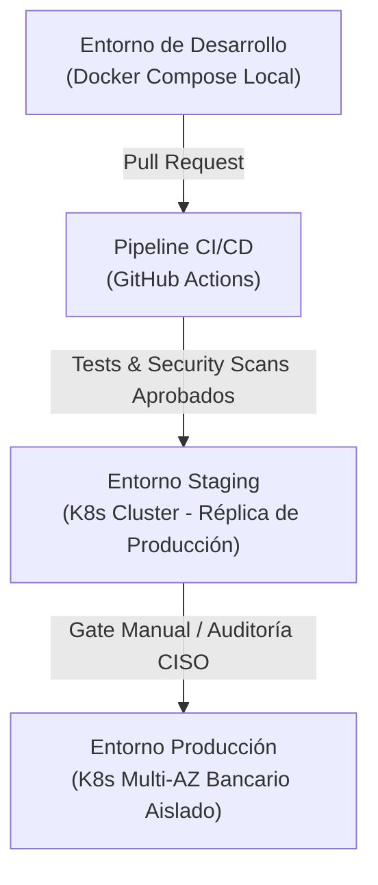

# 10. Plan de Despliegue, CI/CD y Observabilidad

## 1. Topología de Entornos (Dev, Staging y Producción)

- **Desarrollo**: Despliegue ágil mediante `docker-compose.yml` local que levanta PostgreSQL, Redis, FastAPI, React, n8n, Ollama, Prometheus y Grafana.
- **Staging**: Clúster Kubernetes con configuración idéntica a producción, alimentado con datasets sanitizados de prueba para ensayos de estrés y validación funcional.
- **Producción**: Clúster Kubernetes Multi-AZ en red bancaria privada con aislamiento físico/lógico, bases de datos gestionadas de alta disponibilidad (PostgreSQL con replicación síncrona) y almacenamiento cifrado.

---

## 2. Pipeline de Integración y Entrega Continua (CI/CD con GitHub Actions)

El archivo `.github/workflows/pipeline.yml` ejecuta las siguientes fases automáticas:
1. **Linting y Tipado Estricto**:
   - Backend: `flake8`, `black --check`, `mypy --strict`.
   - Frontend: `eslint`, `tsc --noEmit`.
2. **Pruebas Automatizadas**:
   - `pytest` con reporte de cobertura de código (mínimo 85%).
   - Pruebas de integración con servicios de base de datos efímeros.
3. **Escaneos de Seguridad (DevSecOps)**:
   - Análisis estático de código SAST con `bandit` y `semgrep`.
   - Escaneo de secretos expuestos con `trufflehog` o `git-secrets`.
   - Escaneo de vulnerabilidades en dependencias con `pip-audit` y `npm audit`.
4. **Construcción y Escaneo de Contenedores**:
   - Generación de imágenes Docker con etiquetas inmutables basadas en Git commit SHA.
   - Escaneo de imágenes con `Trivy` para descartar vulnerabilidades de sistema operativo base.
5. **Despliegue Progresivo**:
   - Aplicación de Helm Charts en Kubernetes mediante despliegues Canary o Blue/Green para garantizar cero tiempo de inactividad (Zero-Downtime Deployment).

---

## 3. Estrategia de Escalado en Kubernetes (HPA & StatefulSets)
- **FastAPI Backend**: Desplegado como `Deployment` sin estado con **Horizontal Pod Autoscaler (HPA)**.
  - Regla de escalado: Mínimo 3 réplicas, máximo 20 réplicas.
  - Disparadores: Utilización media de CPU > 70% o métricas personalizadas de Prometheus (`http_requests_per_second > 150`).
- **PostgreSQL**: Desplegado como `StatefulSet` con discos NVMe dedicados o utilizando el servicio de base de datos en nube privada certificada con réplicas de lectura (Read Replicas) para consultas de reportes pesados.
- **n8n**: Desplegado en modo Queue con Redis y múltiples instancias de `n8n-worker` para ejecución masiva y paralela de workflows de automatización.

---

## 4. Pila de Observabilidad y Telemetría

### 4.1 Métricas con Prometheus y Método RED
FastAPI expone `/metrics` mediante `prometheus-fastapi-instrumentator`:
- **Rate**: Peticiones por segundo clasificadas por método, ruta y código de respuesta HTTP (`http_requests_total`).
- **Errors**: Conteo y ratio de fallos HTTP 4xx y 5xx (`http_exceptions_total`).
- **Duration**: Histograma de latencia de peticiones en milisegundos (`http_request_duration_seconds`).

### 4.2 Dashboards en Grafana
- **Dashboard Operativo SOC**: Indicadores en tiempo real de volumen de escaneos, dominios bloqueados y utilización de los workers de n8n.
- **Dashboard Ejecutivo CISO**: Tiempos MTTR/MTTD consolidados, incidentes contenidos antes de impacto y disponibilidad porcentual de la plataforma (SLA 99.95%).

### 4.3 Gestión Centralizada de Logs con Grafana Loki
- Todos los contenedores emiten logs estructurados en formato **JSON** a través de `stdout`/`stderr`.
- El agente **Promtail** recolecta, etiqueta y despacha los logs hacia **Grafana Loki**.
- Permite a los analistas correlacionar en una sola consulta el ID de una solicitud HTTP, la traza de ejecución de LangChain y la consulta ejecutada en PostgreSQL.

