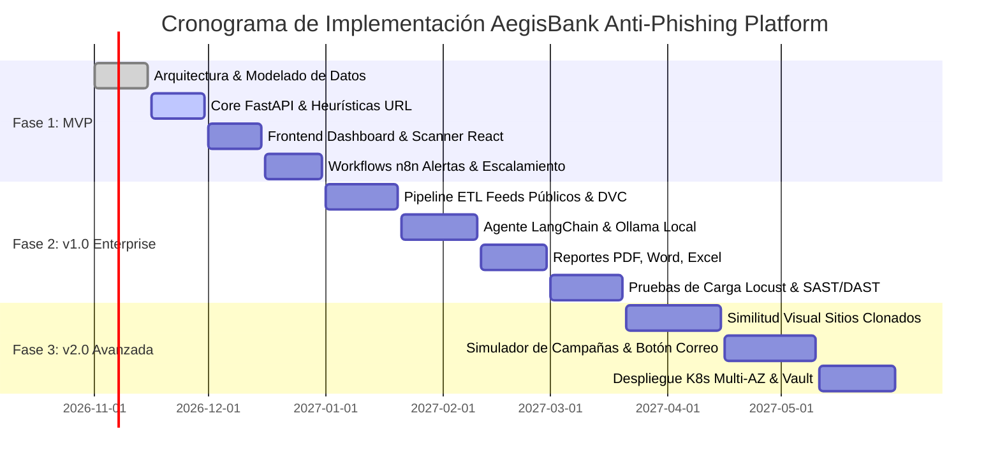

# 11. Roadmap por Fases, Estimaciones y Preguntas Abiertas

## 1. Roadmap de Implementación

---

## 2. Estimación de Esfuerzo por Sprints y Roles

Metodología ágil Scrum en sprints de 2 semanas:

| Fase | Sprint | Entregables Principales | Story Points | Perfiles Requeridos |
| :--- | :---: | :--- | :---: | :--- |
| **Fase 1: MVP** (Meses 1-2) | S1 - S2 | Infraestructura Docker, esquemas PostgreSQL con `pg_trgm`, motor heurístico de URLs (typosquatting y homógrafos), autenticación JWT/RBAC. | 55 SP | 1 Arq. Software, 2 Backend Devs, 1 DBA |
| | S3 - S4 | Frontend React (Dashboard KPIs con Recharts, Scanner de URLs), 3 flujos base en n8n (alertas críticas, escalamiento por SLA). | 48 SP | 2 Frontend Devs, 1 DevOps, 1 Analista SOC |
| **Fase 2: v1.0** (Meses 3-4) | S5 - S6 | Integración de LangChain con Ollama on-premise, análisis de correos EML y Quishing (QR), pipeline ETL de PhishTank con versionado. | 62 SP | 1 AI Engineer, 2 Backend Devs, 1 QA |
| | S7 - S8 | Motor de reportes multiformato (PDF ReportLab, DOCX, XLSX), instrumentación Prometheus/Grafana, pruebas de carga con Locust. | 50 SP | 1 Backend Dev, 1 DevOps, 1 QA Automation |
| **Fase 3: v2.0** (Meses 5-6) | S9 - S10 | Motor de similitud visual para portales bancarios clonados (SSIM / embeddings de visión), prototipado en LangFlow para analistas SOC. | 58 SP | 1 AI Engineer, 1 Frontend Dev, 1 Backend Dev |
| | S11 - S12| Módulo de simulaciones de phishing para empleados, botón de reporte en Outlook/Web, despliegue en Kubernetes de producción con Vault. | 65 SP | 1 Arq. Ciberseguridad, 2 DevOps, 1 Compliance Officer |

**Total Esfuerzo Estimado**: **338 Story Points** (~24 semanas / 6 meses para entrega comercial completa lista para auditoría regulatoria).

---

## 3. Supuestos y Preguntas Abiertas para el Cliente Bancario

### 3.1 Supuestos de Diseño
1. El banco cuenta con infraestructura virtualizada o clúster Kubernetes privado (OpenShift, Tanzu, EKS on-premises o AKS privado) con GPUs asignadas para inferencia de Ollama si se procesan más de 50 consultas de IA concurrentes.
2. El equipo de redes y telecomunicaciones del banco concederá acceso al resolver DNS interno para inyectar zonas de bloqueo RPZ (Response Policy Zone) automáticas.
3. El proveedor de correo corporativo (Microsoft 365 Exchange Online o Google Workspace) permite la instalación de complementos centralizados (add-in) para desplegar el botón "Reportar Phishing".
4. Se cuenta con licencias para feeds comerciales adicionales (VirusTotal Enterprise, AbuseIPDB) en caso de requerir enriquecimiento cruzado más allá de las fuentes públicas.

### 3.2 Preguntas Abiertas para Refinamiento Técnico
1. **SSO e Identidad**: ¿La federación de identidades corporativas del banco se realiza mediante Active Directory vía Kerberos/LDAP o a través de SAML 2.0 / OpenID Connect (Azure AD / Okta / PingFederate)?
2. **Topología de Vault**: ¿Dispone la institución de un clúster centralizado de HashiCorp Vault en operación, o se debe aprovisionar una instancia dedicada para esta plataforma?
3. **Manejo de Takedowns**: ¿Posee el banco un acuerdo contractual con algún registrador de dominios o proveedor externo especializado en Takedowns judiciales/registrales para delegarle la suspensión legal de dominios en lugar de solo emitir el reporte por correo?
4. **Almacenamiento de Evidencias Forenses**: ¿Cuál es el repositorio designado para la custodia de evidencias digitales a largo plazo? ¿Se utilizará almacenamiento compatible con S3 en almacenamiento tipo WORM (ej. MinIO con Object Lock o Dell ECS)?
5. **Gobernanza de Modelos LLM**: ¿La política de cumplimiento del banco permite el uso de Azure OpenAI en tenant privado para enriquecimiento de telemetría no confidencial, o la directiva corporativa exige un aislamiento total on-premise (100% Ollama)?

